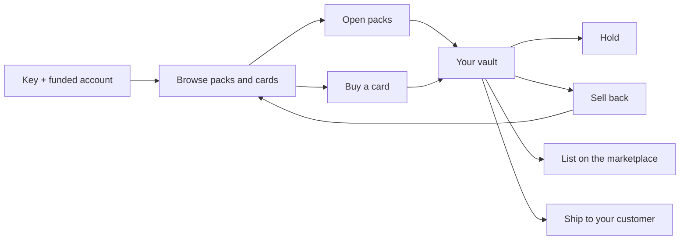

A partner is a normal CatchBack account with an API key linked to it. Every purchase, sell-back and listing runs through the same code and the same rules as our own app, at the same list prices. This page is the map; each step links to the guide that covers it.



<Steps>
  <Step title="Get a key and fund the account">
    You sign up for a CatchBack account; we create a key with the scopes you need, link it and send it to you. You fund the account with USDC or a wire, and purchases spend only that Wallet Balance. [Getting set up](/partner-api/onboarding), [Funding in USDC](/partner-api/funding)
  </Step>
  <Step title="Decide what to buy">
    [List packs](/partner-api/endpoints/list-packs) and [Get a pack's pool](/partner-api/endpoints/get-pack-pool) show what you can open and what it can pull. [Search cards](/partner-api/endpoints/search-cards) shows every card for sale. Inventory is shared with every customer, so treat what you read as a cache and let the purchase response be the final word ([why](/partner-api/errors-and-limits#inventory-is-point-in-time)).
  </Step>
  <Step title="Open packs or buy cards">
    Every purchase carries your own order id, so a retry can never charge you twice. Each pull comes back with its CatchBack offer and a proof you can check. [Opening packs](/partner-api/opening-packs), [Buying and listing cards](/partner-api/trading-cards)
  </Step>
  <Step title="Decide what to do with each card">
    Everything lands in your vault. Hold it, sell it back to us (100% for the first 5 minutes after a pull at `standard`), list it on the marketplace, or ship it to your customer. [Your vault and sell-backs](/partner-api/vault-and-sell-backs), [Shipping cards](/partner-api/shipping)
  </Step>
  <Step title="Reconcile">
    [Balance history](/partner-api/endpoints/get-balance-history) lists every change to your balance, and [List orders](/partner-api/endpoints/list-orders) the detail of each order. A [webhook](/partner-api/webhooks) tells you when an order finishes, a listing sells, a shipment moves or a withdrawal settles, without polling. When you're ready to cash out: [Withdraw](/partner-api/funding#withdraw).
  </Step>
</Steps>

## Every request

Send your key as `Authorization: Bearer cb_live_…`. Every endpoint except Who am I requires one scope, and anything that touches your balance or cards also needs the key to be linked to your account. [Authentication](/partner-api/authentication)

A key acts as one CatchBack account, so we don't know which of your customers a pull or an order is for. Record that on your side, against each `pull_id` and the order ids you choose.

## A typical bot loop

```text
whoami                         -> confirm the key's account
get_balance                    -> enough funds? limits left today?
list_packs / get_pack_pool     -> pick a pack
buy_packs (new order id)       -> on a timeout, resend the SAME order id
for each pull:
    keep it, or sell_back_cards within 5 minutes for the fresh rate
wait until next_purchase_at    -> repeat
```

Before you run it on real money, go through [Going live](/partner-api/going-live).

## Doing it with an AI agent

The [MCP server](/partner-api/mcp) gives an AI agent every step above as tools, with the same key. Each tool calls the same endpoint, so the limits, the order-number rules and the rates are identical. Your agent only sees the tools your key has scopes for.
