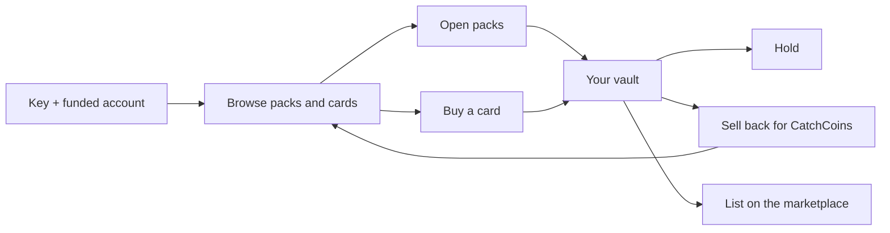

A partner is a normal CatchBack account with an API key linked to it. Every purchase, sell-back and listing runs through the same code and the same rules as our own app, at the same list prices. This page walks through the whole lifecycle; each step links to the endpoint that does it.



## 1. Get a key and fund your account

1. **Account and key.** You sign up for a CatchBack account. We create an API key with the [scopes](/partner-api/authentication#scopes) you need and link it to that account. The key is shown once; store it like a bank credential.
2. **Funding.** You send USDC to your deposit address ([Funding in USDC](/partner-api/funding)), or wire funds and we credit them. Either way the money lands in your account's CatchCoins balance (1 CatchCoin = $1). Purchases spend only that balance. There are no promo codes, add-ons or bonus balance on partner purchases.
3. **Check the link.** Call [Who am I](/partner-api/endpoints/get-me). It works with any key and shows which account your key acts as. Quote that `account.id` when you fund the account or contact us.
4. **Track your own customers.** A key acts as one CatchBack account, so we don't know which of your customers a pull or an order is for. Record that on your side, against each `pull_id` and the order ids you choose.
5. **Try it first, if you like.** [Testing](/partner-api/testing) covers test accounts, what they can't do, and what to test with small real orders instead.

## 2. Every request

Send your key as `Authorization: Bearer cb_live_…`. Every endpoint except Who am I requires one scope; a key without it gets a `403`. Anything that touches your balance or cards also needs the key to be linked to your account. [Public card metadata](/partner-api/endpoints/get-public-card), [Verify a pull](/partner-api/verify-a-pull) and the list of countries we ship to take no key. Details: [Authentication](/partner-api/authentication).

## 3. Decide what to buy

| You want to know | Call |
|---|---|
| Which packs you can buy, and at what price | [List packs](/partner-api/endpoints/list-packs) |
| What a pack can pull, at what odds | [Get a pack's pool](/partner-api/endpoints/get-pack-pool) |
| Which cards are for sale, from the shop and from other users | [Search cards](/partner-api/endpoints/search-cards) |
| A card's details, its value over time and its recent sales | [Get a card](/partner-api/endpoints/get-card), [Price history](/partner-api/endpoints/get-price-history), [Card activity](/partner-api/endpoints/get-card-activity) |
| Your balance, and how much of today's limits are left | [Get account](/partner-api/endpoints/get-account) |

All of these are snapshots. Inventory is shared with every CatchBack customer, so a card can be pulled or sold at any moment. Treat what you read as a cache, and let the purchase response be the final word ([why](/partner-api/errors-and-limits#inventory-is-point-in-time)).

## 4. Open packs

[Buy packs](/partner-api/endpoints/buy-packs) opens 1–10 packs of one type per request. Here is what happens when you send one:

<Steps>
  <Step title="We record your order number">
    Before anything is charged, we record your `Idempotency-Key` as an order number. From then on, sending that order again can never charge you twice (see [step 6](#6-if-something-goes-wrong-retry-the-same-order)).
  </Step>
  <Step title="We check your limits">
    By default your key can open 100 packs per day and send one pack purchase per minute; we can change both for your key on request. Over either limit is a `429` that says when to retry, and nothing is charged. [Rate limits](/partner-api/rate-limits#pack-purchases)
  </Step>
  <Step title="We charge and open the packs">
    We charge the list price for every pack from your balance, then open them with the same odds a customer gets at your chosen risk level. The order is all-or-nothing: if any pack fails to open, the whole charge is refunded and no pulls stand.
  </Step>
  <Step title="You get every hit back">
    Each pull comes back with its `pull_id`, the card, its value, the rarity and odds of the hit, its CatchBack offer (what we pay now, and what we pay after the first 5 minutes), and a `proof` you can check: [Verify a pull](/partner-api/verify-a-pull). The cards are already in your vault.
  </Step>
</Steps>

## 5. Buy a card

[Buy a card](/partner-api/endpoints/buy-card) buys one card from [Search cards](/partner-api/endpoints/search-cards), from the shop or another user's fixed-price listing.

- You pay the card's price plus a $1 buyer fee.
- You send `max_price`, normally the `price` the search showed. If the price has gone up since, you get `409 PRICE_CHANGED` with the new price, and nothing is charged.
- If someone else got the card first, you get `409 CARD_NO_LONGER_AVAILABLE`. Search again.
- Card buys have daily caps on the number of cards and on dollars spent, but no per-minute limit. [Rate limits](/partner-api/rate-limits#card-purchases)
- The card lands in your vault.

## 6. If something goes wrong, retry the same order

Every purchase needs an `Idempotency-Key`: your own order id. Generate one per order and reuse it on every attempt of that order.

| You resend the same order id and… | You get |
|---|---|
| The order had finished | The original response, with `"idempotent_replay": true`. Nothing is charged again |
| The order is still running | `409 IDEMPOTENCY_IN_PROGRESS`. Wait a moment and resend |
| An attempt with that id failed just as you resent it | `409 IDEMPOTENCY_RETRY`. Resend it |
| The order had failed | It runs again. A failed order refunds itself |
| You changed the body | `422 IDEMPOTENCY_KEY_REUSED`. A different order needs a new id |

If your connection drops mid-order, resend the same order id; never a new one, which would be a second order. To see where an order stands without resending it, call [Get an order](/partner-api/endpoints/get-order) with its `checkout_id`.

If an order is interrupted on our side after you were charged, your resends get `409 IDEMPOTENCY_IN_PROGRESS` until we close the order from our own records, usually within about 10 minutes. After that, a resend returns a shorter body than the original, marked `"reconciled": true`. For a pack order it has `checkout_id`, `pack_type`, `quantity`, `total_charged`, the `pull_ids` and a `message`, but no `pulls` and no `summary`, so read the cards and their offers from [Get vault](/partner-api/endpoints/get-vault). Both reconciled bodies, pack and card: [Idempotency](/partner-api/idempotency#timeouts-and-interrupted-orders). If an order is still `409` after 30 minutes, contact us with the order id.

## 7. Decide what to do with each card

Everything you pull or buy is held by CatchBack in your vault. [Get vault](/partner-api/endpoints/get-vault) lists it, with today's sell-back offer per card. You have four options.

<CardGroup cols={2}>
  <Card title="Hold" icon="vault">
    Keep it in your vault. Its offer is listed in Get vault.
  </Card>
  <Card title="Sell back" icon="rotate-left" href="/partner-api/endpoints/sell-back">
    Sell it to CatchBack for CatchCoins at our guaranteed rates.
  </Card>
  <Card title="List" icon="tag" href="/partner-api/endpoints/list-card">
    Put it on the marketplace at a fixed price, and change the price in place. A sale pays you the price less a $1 seller fee. Delist to sell it back.
  </Card>
  <Card title="Ship" icon="truck" href="/partner-api/shipping">
    Send it to your customer's address, paid from your balance at the carrier's full rate.
  </Card>
</CardGroup>

What a sell-back pays, the same as any customer:

| The card was… | Within 5 minutes | For 7 days | After that |
|---|---|---|---|
| Pulled from a pack | 90% of the value at pull | 80% of the value at pull | 80% of market value |
| Bought | 80% of the lower of the price you paid and its market value at purchase | same | 80% of market value |

A card bought from another user's listing can instead carry over that seller's 7-day lock, if it is lower and still running ([Buy a card](/partner-api/endpoints/buy-card)).

Luxury goods sell back only within 5 minutes of the pull. Energy cards from base packs pay 100% of their value, with no window and no lock.

A card from a pack that holds its cards pays a flat 90% for the hold, can't be kept, listed or shipped through the API, and is sold back automatically when the hold ends.

The fresh 90% window is why the pack response includes the offer: decide on each pull right away. [Quote a sell-back](/partner-api/endpoints/quote-sell-back) gives every amount ahead of time, with the exact UTC time each one ends. Sell-backs have no rate limit per key, and each card pays out once, so retrying a sell-back is safe. See [Liquidity](/about-catchback/liquidity) for the full rules.

## 8. A typical bot loop

```text
whoami                         -> confirm the key's account
get_balance                    -> enough funds? limits left today?
list_packs / get_pack_pool     -> pick a pack
buy_packs (new order id)       -> on a timeout, resend the SAME order id
for each pull:
    keep it, or sell_back_cards within 5 minutes for the fresh rate
wait until next_purchase_at    -> repeat
```

To reconcile your balance, [Balance history](/partner-api/endpoints/get-balance-history) lists every change to it in a window: orders, shipping charges, withdrawals and money in. [List orders](/partner-api/endpoints/list-orders) has the full detail of each order. To hear when an order finishes without polling, use a [webhook](/partner-api/webhooks).

## Doing it with an AI agent

The [MCP server](/partner-api/mcp) gives an AI agent every step above as tools, with the same key. Each tool calls the same endpoint, so the limits, the order-number rules and the rates are identical. Your agent only sees the tools your key has scopes for.
