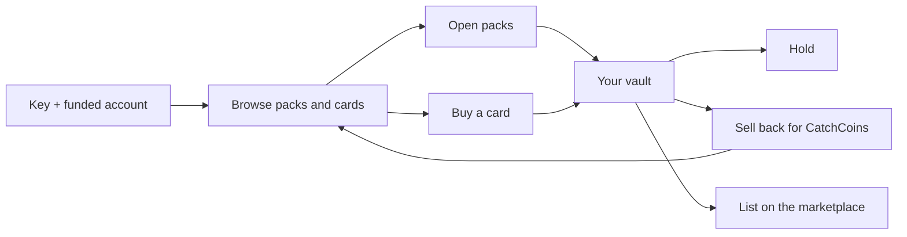

A partner is a normal CatchBack account with an API key linked to it. Every purchase, sell-back and listing runs through the same code and the same rules as our own app, at the same list prices. This page walks through the whole lifecycle; each step links to the endpoint that does it.



## 1. Get a key and fund your account

1. **Account and key.** You sign up for a CatchBack account. We create an API key with the [scopes](/partner-api/authentication#scopes) you need and link it to that account. The key is shown once; store it like a bank credential.
2. **Funding.** You wire funds and we credit your account's CatchCoins balance (1 CatchCoin = $1). Purchases spend only that balance. There are no promo codes, add-ons or bonus balance on partner purchases.
3. **Check the link.** Call [Who am I](/partner-api/endpoints/get-me). It works with any key and shows which account your key acts as. Quote that `account.id` when you fund the account or contact us.

## 2. Every request

Send your key as `Authorization: Bearer cb_live_…`. Each endpoint requires one scope; a key without it gets a `403`. Anything that touches your balance or cards also needs the key to be linked to your account. Details: [Authentication](/partner-api/authentication).

## 3. Decide what to buy

| You want to know | Call |
|---|---|
| Which packs you can buy, and at what price | [List packs](/partner-api/endpoints/list-packs) |
| What a pack can pull, at what odds | [Get a pack's pool](/partner-api/endpoints/get-pack-pool) |
| Which cards are for sale, from the shop and from other users | [Search cards](/partner-api/endpoints/search-cards) |
| Your balance, and how much of today's limits are left | [Get account](/partner-api/endpoints/get-account) |

All of these are snapshots. Inventory is shared with every CatchBack customer, so a card can be pulled or sold at any moment. Treat what you read as a cache, and let the purchase response be the final word ([why](/partner-api/errors-and-limits#inventory-is-point-in-time)).

## 4. Open packs

[Buy packs](/partner-api/endpoints/buy-packs) opens 1–10 packs of one type per request. Here is what happens when you send one:

<Steps>
  <Step title="We record your order number">
    Before anything is charged, we record your `Idempotency-Key` as an order number. From then on, sending that order again can never charge you twice (see [step 6](#6-if-something-goes-wrong-retry-the-same-order)).
  </Step>
  <Step title="We check your limits">
    By default your key can open 100 packs per day and send one pack purchase per minute; both are set per partner. Over either limit is a `429` that says when to retry, and nothing is charged. [Purchase limits](/partner-api/errors-and-limits#purchase-limits)
  </Step>
  <Step title="We charge and open the packs">
    We charge the list price for every pack from your balance, then open them with the same odds a customer gets at your chosen risk level. The order is all-or-nothing: if any pack fails to open, the whole charge is refunded and no pulls stand.
  </Step>
  <Step title="You get every hit back">
    Each pull comes back with its `pull_id`, the card, its value, the rarity and odds of the hit, and its CatchBack offer: what we pay now, and what we pay after the first 5 minutes. The cards are already in your vault.
  </Step>
</Steps>

## 5. Buy a card

[Buy a card](/partner-api/endpoints/buy-card) buys one card from [Search cards](/partner-api/endpoints/search-cards), from the shop or another user's fixed-price listing.

- You pay the card's price plus a $1 buyer fee.
- You send `max_price`, normally the `price` the search showed. If the price has gone up since, you get `409 PRICE_CHANGED` with the new price, and nothing is charged.
- If someone else got the card first, you get `409 CARD_NO_LONGER_AVAILABLE`. Search again.
- Card buys have daily caps on the number of cards and on dollars spent, but no per-minute limit. [Card limits](/partner-api/errors-and-limits#card-limits)
- The card lands in your vault.

## 6. If something goes wrong, retry the same order

Every purchase needs an `Idempotency-Key`: your own order id. Generate one per order and reuse it on every attempt of that order.

| You resend the same order id and… | You get |
|---|---|
| The order had finished | The original response, with `"idempotent_replay": true`. Nothing is charged again |
| The order is still running | `409 IDEMPOTENCY_IN_PROGRESS`. Wait a moment and resend |
| The order had failed | It runs again. A failed order refunds itself |
| You changed the body | `422 IDEMPOTENCY_KEY_REUSED`. A different order needs a new id |

If your connection drops mid-order, resend the same order id; never a new one, which would be a second order. If an order is interrupted on our side after you were charged, we complete it, and your resend returns the result. That usually takes about 10 minutes. If an order is still `409` after 30 minutes, contact us with the order id.

## 7. Decide what to do with each card

Everything you pull or buy is held by CatchBack in your vault. [Get vault](/partner-api/endpoints/get-vault) lists it, with today's sell-back offer per card. You have three options.

<CardGroup cols={3}>
  <Card title="Hold" icon="vault">
    Keep it in your vault. Its offer is listed in Get vault.
  </Card>
  <Card title="Sell back" icon="rotate-left" href="/partner-api/endpoints/sell-back">
    Sell it to CatchBack for CatchCoins at our guaranteed rates.
  </Card>
  <Card title="List" icon="tag" href="/partner-api/endpoints/list-card">
    Put it on the marketplace at a fixed price. Delist to sell it back.
  </Card>
</CardGroup>

What a sell-back pays, the same as any customer:

| The card was… | Within 5 minutes | For 7 days | After that |
|---|---|---|---|
| Pulled from a pack | 90% of the value at pull | 80% of the value at pull | 80% of market value |
| Bought | 80% of the lower of the price you paid and its market value at purchase | same | 80% of market value |

The fresh 90% window is why the pack response includes the offer: decide on each pull right away. Sell-backs aren't rate-limited, and each card pays out once, so retrying a sell-back is safe. See [Liquidity](/about-catchback/liquidity) for the full rules.

## 8. A typical bot loop

```text
whoami                         -> confirm the key's account
get_balance                    -> enough funds? limits left today?
list_packs / get_pack_pool     -> pick a pack
buy_packs (new order id)       -> on a timeout, resend the SAME order id
for each pull:
    keep it, or sell_back_cards within 5 minutes for the fresh rate
wait until next_purchase_at    -> repeat
```

## Doing it with an AI agent

The [MCP server](/partner-api/mcp) gives an AI agent every step above as tools, with the same key. Each tool calls the same endpoint, so the limits, the order-number rules and the rates are identical. Your agent only sees the tools your key has scopes for.
