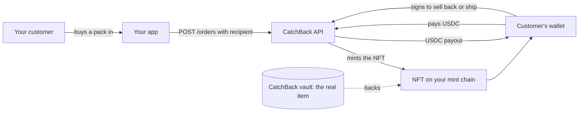
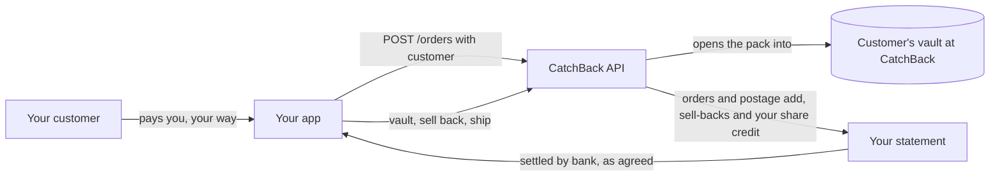

Every partner program runs on exactly one of two models. You choose it in **Get started** in your manager (`catchback.com/<slug>/admin/api`) before you go live, and your sandbox follows the same choice. If you need both, run two programs.

<CardGroup cols={2}>
  <Card title="Crypto model" icon="wallet" href="#crypto-model">
    Your customers pay from their own crypto wallet. Each pull is minted to that wallet as an NFT they can hold, trade, sell back or ship. You never touch the money.
  </Card>
  <Card title="Non-crypto model" icon="building-columns" href="#non-crypto-model">
    Your customers need no crypto. You buy packs for them and charge them your way; their items stay in a CatchBack vault, and everything settles on one statement between you and us.
  </Card>
</CardGroup>

The model is your program's `payment_mode`: `wallet` for the crypto model, `partner` for the non-crypto model. [`GET /keys`](/partner-api/v2/endpoints/get-key) returns it, so your code can check which one it's talking to.

## At a glance

| | **Crypto model** | **Non-crypto model** |
|---|---|---|
| **`payment_mode`** | `wallet` | `partner` |
| **Best for** | Exchanges and wallet apps whose users hold their own crypto wallet | Apps, games and marketplaces whose users have no crypto wallet |
| **A customer is** | A wallet address (`recipient`) | Your own id for them (`customer`) |
| **Who pays CatchBack for a pack** | The customer, in USDC on Base or Solana, through our hosted payment screen | You, on your statement, within a credit limit. You charge your customer your way |
| **Where the item goes** | An NFT minted to the customer's wallet, backed by the real item in our vault | The customer's vault at CatchBack. You show it in your app |
| **Selling back** | The holder signs a quote; we burn the NFT and send USDC to their wallet | One API call; the payout is credited to your statement and you credit your customer |
| **Shipping** | The holder pays the postage and the NFT is burned, often with a single signature | One API call; the postage goes on your statement |
| **Your revenue share** | Paid monthly to your USDC address | Credited to your statement when each month closes |
| **Limits** | Daily sell-back payout caps per address and per program | A credit limit, plus per-customer and optional per-program daily limits |
| **Crypto your customer sees** | A wallet and a signature | None |
| **Crypto you handle** | None: we mint, pay gas, take payments and send payouts | None |

## Crypto model

1. **Buy.** Your app creates an order for the customer's wallet: [`POST /orders`](/partner-api/v2/endpoints/create-order) with `recipient`. The response carries a payment for the customer to pay within 24 hours ([Payments](/partner-api/v2/payments)).
2. **Receive.** Once paid, the pack opens and the NFT is minted to `recipient` (`paid` → `rolled` → `minted`, [Orders](/partner-api/v2/orders)).
3. **Hold or trade.** It's a standard NFT in the customer's own wallet: [`GET /wallets/{address}/tokens`](/partner-api/v2/endpoints/list-wallet-tokens) shows what they hold and today's sell-back.
4. **Sell back or ship.** The holder signs a quote and the NFT is burned: USDC goes to their wallet ([Sell-back](/partner-api/v2/sell-back)), or the real item ships to them ([Shipping](/partner-api/v2/shipping)).

Money moves only between the customer's wallet and CatchBack. You never collect, forward or hold it.

## Non-crypto model

1. **Buy.** Your app charges your customer however it already does, then creates the order for them by your own id: [`POST /orders`](/partner-api/v2/endpoints/create-order) with `customer`. There's no payment step: the order goes on your statement, and an order that would pass your credit limit is refused and charges nothing.
2. **Receive.** The pack opens straight away into the customer's vault (`paid` → `in_vault`). [`GET /customers/{customer}/vault`](/partner-api/v2/endpoints/get-customer-vault) lists their items, each with what it sells back for right now.
3. **Sell back.** [`POST /customers/{customer}/cards/{card_id}/sellback`](/partner-api/v2/endpoints/sell-back-customer-card) sells an item at its current offer and credits the payout to your statement. You credit your customer your way.
4. **Ship.** [Estimate](/partner-api/v2/endpoints/estimate-customer-shipment), then [create](/partner-api/v2/endpoints/create-customer-shipment) a shipment of 1-10 vault items; the postage goes on your statement and we ship with tracking.
5. **Settle.** [`GET /settlement`](/partner-api/v2/endpoints/get-settlement) shows what you owe against your credit limit and every entry by your customer id. You settle the balance with us as agreed.

Money moves only between you and us. Your customer never has a CatchBack account to log in to, a balance, or a wallet.

Full details: [Non-crypto model](/partner-api/v2/settlement).

## What you build

<CardGroup cols={2}>
  <Card title="Crypto model" icon="wallet">
    - Show packs and their odds
    - Collect the customer's wallet address
    - Create the order and hand its payment to the customer
    - Show the pull once it's minted
    - For sell-back and shipping: get the quote, have the holder sign it, send the burn
    - Webhooks for order, payout and shipment updates
  </Card>
  <Card title="Non-crypto model" icon="building-columns">
    - Show packs and their odds
    - Charge your customer, then create the order with your id for them
    - Show the pull and the customer's vault
    - Sell back on their request, and credit them
    - Ship on their request, with their address
    - Read your statement and settle it with us
    - Webhooks for order, sell-back and shipment updates
  </Card>
</CardGroup>

## Endpoints by model

| Used by | Endpoints |
|---|---|
| **Both models** | Catalog and odds (`GET /catalog/packs`, `GET /catalog/packs/pool`), orders (`POST /orders`, `GET /orders`, `GET /orders/{id}`, `GET /orders/{id}/verification`), webhooks, keys, `GET /revenue`, `POST /sandbox/tick`, `POST /sandbox/shipments/{id}` |
| **Crypto model only** | Holdings (`GET /wallets/{address}/tokens`, `GET /tokens/{tokenId}`), sell-back (`POST /tokens/{tokenId}/quote`, `POST /tokens/{tokenId}/burn`, `GET /quotes`, `GET /quotes/{quoteId}`), shipping (`POST /shipments/estimate`, `POST /shipments`, `POST /tokens/{tokenId}/shipment/estimate`, `POST /tokens/{tokenId}/shipment`, `GET /shipments`, `GET /shipments/{id}`, `POST /shipments/{id}/renew`), `POST /sandbox/payments/{intentId}` |
| **Non-crypto model only** | `GET /customers/{customer}/vault`, `POST /customers/{customer}/cards/{card_id}/sellback`, `POST /customers/{customer}/shipments/estimate`, `POST /customers/{customer}/shipments`, `GET /customers/{customer}/shipments`, `GET /settlement` |

An endpoint for the other model answers `400 NOT_PARTNER_SETTLED` (non-crypto endpoints on a crypto-model program) or refuses the wallet fields (`WALLET_FIELDS_NOT_ACCEPTED` when a non-crypto order sends `recipient`).

## Which should I choose?

- **Your users already hold self-custody wallets with you**, as on an exchange or wallet app: the **crypto model**. You never take payments or hold funds, and your users own their NFTs outright.
- **Your users don't have crypto wallets**, or you'd rather keep billing in your own system: the **non-crypto model**. It needs a credit limit agreed with us, starting at $10,000.
- **Not sure?** Ask us at support@catchbackcards.com. Your sandbox lets you build either one before deciding, as long as you haven't gone live.

## Next

<CardGroup cols={2}>
  <Card title="Build the crypto model" icon="wallet" href="/partner-api/v2/quickstart">
    The sandbox walkthrough: buy, pay, mint, sell back, ship.
  </Card>
  <Card title="Build the non-crypto model" icon="building-columns" href="/partner-api/v2/quickstart#non-crypto-model-in-the-sandbox">
    The sandbox walkthrough: order, vault, sell back, ship, statement.
  </Card>
</CardGroup>
