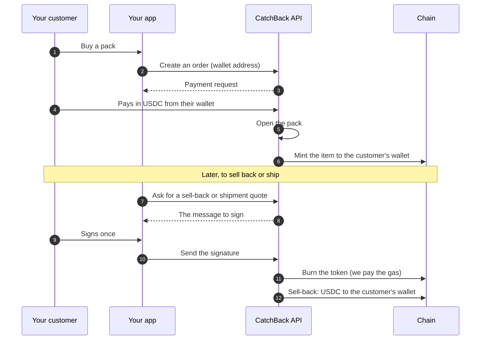
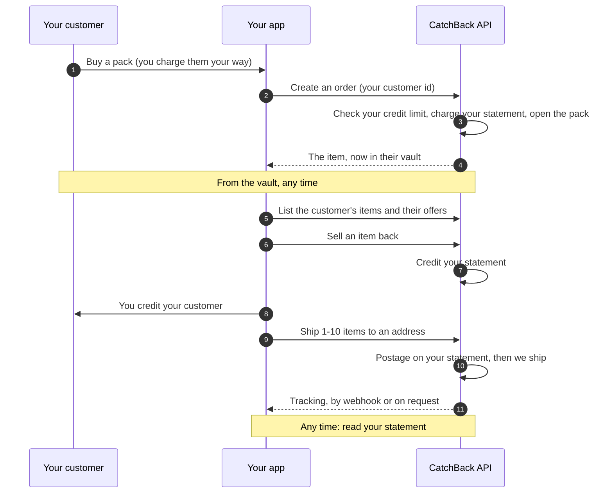
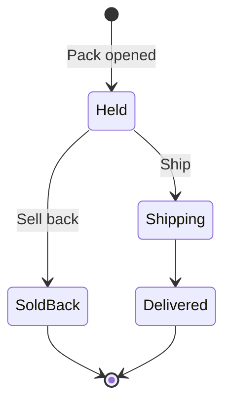

Your customers buy CatchBack packs inside your app. Every pack pulls a real item that we store. This page explains where that item goes, how your customer sells it back or ships it, and how money moves, whether or not your customers have crypto wallets.

## The short version

| If your customers… | You use | The item goes |
|---|---|---|
| have a crypto wallet with you | **Crypto Wallet model** | to their wallet, as an NFT on Base, Solana or your own chain, the moment the pack opens |
| don't have a crypto wallet | **Non-crypto model** | into a CatchBack vault kept for that customer |

Either way, the packs you sell, their odds and your customers' buyback rate are [agreed with you](#your-programs-terms), and your customers always buy and sell back at the terms they're shown. What the two models change is who pays and gets paid, and where the item is kept.

You choose in **Get started** in your manager (`catchback.com/<slug>/admin/api`) before you go live; your sandbox follows the same choice. In the API it's your program's `payment_mode`: `wallet` or `partner`, returned by [`GET /keys`](/partner-api/v2/endpoints/get-key). If you need both, run two programs.

## Who's involved

<CardGroup cols={2}>
  <Card title="CatchBack" icon="vault">
    We hold the physical items, run the packs and the sell-back offer, and ship.
  </Card>
  <Card title="You" icon="store">
    You sell packs in your own app, calling our API with your key, and earn a revenue share.
  </Card>
  <Card title="Your customer" icon="user">
    Buys through your app. Never needs a CatchBack login.
  </Card>
  <Card title="Their wallet, if they have one" icon="wallet">
    The crypto wallet they already have with you. We never create it or hold its keys.
  </Card>
</CardGroup>

## Crypto Wallet model

Your customer pays from their own wallet, and the item is minted to it as an NFT. They sell back or ship by signing one message, and we pay the gas.

One-tap shipping pays the postage and burns the token with that same single signature.

**The calls:** [create an order](/partner-api/v2/endpoints/create-order) with `recipient` (2), its [payment](/partner-api/v2/payments) (3-4), [follow it](/partner-api/v2/endpoints/get-order) to `minted` (6), [quote a sell-back](/partner-api/v2/endpoints/create-sellback-quote) or [a shipment](/partner-api/v2/endpoints/create-token-shipment) (7-8), [send the signed burn](/partner-api/v2/endpoints/relay-burn) (10-11). Guides: [Sell-back](/partner-api/v2/sell-back), [Shipping](/partner-api/v2/shipping).

### Any chain: Base, Solana or yours

The Crypto Wallet model is chain agnostic. Your program mints on the chain your users already use, set when you join. Payments, payouts, gas and the API work the same way on all of them.

| Mint chain | Chain key | What your customers hold |
|---|---|---|
| **Base** | `evm:8453` | A standard ERC-721 NFT |
| **Solana** | `solana:mainnet` | A Metaplex Core asset |
| **Your own chain** (any EVM-compatible chain) | `evm:<chainId>`, for example `evm:196` for X Layer | A standard ERC-721 NFT, from our contract deployed on your chain |

Whatever the mint chain, customers pay in USDC on Base or Solana, we pay the network fee for every mint, and sell-backs pay out in USDC. Details: [Chains, tokens and metadata](/partner-api/v2/chains-and-metadata).

## Non-crypto model

You pay for your customers' packs and receive their sell-backs, on one statement. Their items stay in a vault we keep for each customer. Your customers never see a crypto step; you charge and credit them however you like.

No payment request, no wallet and no signature: every call is server to server with your key.

**The calls:** [create an order](/partner-api/v2/endpoints/create-order) with `customer` (2), [the customer's vault](/partner-api/v2/endpoints/get-customer-vault) (5), [sell back](/partner-api/v2/endpoints/sell-back-customer-card) (6), [estimate](/partner-api/v2/endpoints/estimate-customer-shipment) and [create a shipment](/partner-api/v2/endpoints/create-customer-shipment) (9), [their shipments](/partner-api/v2/endpoints/list-customer-shipments) (11), [your statement](/partner-api/v2/endpoints/get-settlement). Guide: [Non-crypto model](/partner-api/v2/settlement).

## Side by side

| | **Crypto Wallet model** | **Non-crypto model** |
|---|---|---|
| **Who the customer is** | Their wallet address (`recipient`) | Your customer id (`customer`) |
| **Who pays for a pack** | The customer, in USDC from their wallet | You, on your statement |
| **Where the item goes** | Minted to their wallet | Their vault with us |
| **Sell back** | Customer signs once; USDC to their wallet | One API call; credited to your statement |
| **Ship** | Customer signs once; postage paid in the same step | One API call; postage on your statement |
| **Showing their items** | The tokens in their wallet | Their vault, from the API |
| **Chain** | Base, Solana or your own chain | None |
| **Crypto your customer sees** | A wallet and one signature | None |
| **Limits** | Per-address and per-program sell-back payout caps | A credit limit plus per-customer and optional per-program daily limits |

## An item's life

- **Held** means an NFT in your customer's wallet (Crypto Wallet model), or an item in their vault (Non-crypto model). Either way we keep the physical item until it ships.
- **Sold back** pays the sell-back offer agreed for your program, including a higher rate for an item sold back within minutes of the pull. The API always shows the offer on each item. For 7 days after an item is pulled, its offer is based on its value when pulled.
- An item is never in two places: one live token at most, on any chain, and never both a token and a vault item.

## Where money moves

| Event | **Crypto Wallet model** | **Non-crypto model** |
|---|---|---|
| **Buying a pack** | Customer's wallet → CatchBack, in USDC | Added to what you owe on your statement |
| **A pack that can't open** | Refunded in USDC to the customer | Taken back off your statement |
| **Selling back** | CatchBack → the customer's wallet, in USDC | Credited to your statement |
| **Shipping** | Customer's wallet → CatchBack, in USDC | Added to your statement |
| **Your revenue share** | Paid monthly to your USDC address | Credited to your statement when each month closes |

<Note>
  Your customer never holds a CatchBack balance. On the Crypto Wallet model, money moves between their wallet and us for each order or sell-back. On the Non-crypto model, it moves only between you and us.
</Note>

### The statement (Non-crypto model)

- **One running account per program.** Packs and shipping add to what you owe; sell-backs, refunds and your revenue share reduce it. Every entry names the customer by your id.
- **Netted and settled by bank** on a cadence set in your agreement. Your revenue share for a month is credited when that month closes.
- **A credit limit, $10,000 to start.** An order or shipment that would take you past it is refused with `CREDIT_LIMIT` and charges nothing, so a bug or a leaked key can't run up an unbounded bill.
- **Daily limits:** $500 per customer per UTC day by default, and an optional cap for the whole program.
- **Not prefunded.** You don't deposit money up front.
- **Value only ever leaves to you.** Sell-backs credit your statement, never a third party.
- **Always readable:** [`GET /settlement`](/partner-api/v2/endpoints/get-settlement) and the Statement page in your manager.

## How we identify your customers

- **Crypto Wallet model:** by the wallet address you send with each order. The same address is always the same customer. Wallets are checked against sanctions lists before every order.
- **Non-crypto model:** by your own id for the customer. The same id is always the same customer and the same vault, and the same id in another partner's program is a different customer.
- Either way, don't send personal data. An address or an opaque id is all we need. You remain responsible for knowing your customers, under our agreement.

## Your program's terms

The packs your program sells, their odds and the buyback rate your customers get are agreed with you at onboarding, so they can differ from another partner's. The API returns your program's own terms everywhere they apply, so read them rather than hard-coding a rate:

- [`GET /catalog/packs`](/partner-api/v2/endpoints/list-packs): the packs you sell, their prices and odds choices;
- [`GET /catalog/packs/pool`](/partner-api/v2/endpoints/get-pack-pool): a pack's odds and its `fresh_buyback_rate`;
- the sell-back offer on every item: a token's `sellback` (Crypto Wallet model) or a vault item's `sellback` (Non-crypto model).

The rates elsewhere in these docs are our standard terms. Your revenue share is agreed the same way and reported on [your revenue statement](/partner-api/v2/endpoints/get-revenue).

## What we guarantee

| Guarantee | What it protects |
|---|---|
| Money and items leave only to the customer's own wallet, or to you | A leaked API key can't send them anywhere else |
| One customer, one set of items | A customer's items never split across accounts |
| One live token per item, on every chain | An item can't be held twice |
| Every pull is a real, stored item at a published value | Your customer always gets your program's sell-back offer on it, as shown |
| Idempotent orders, sell-backs and shipments | A retried call never charges or pays twice |
| A credit limit on every Non-crypto program | What you can owe is always bounded |
| Sanctions screening | We never sell to or pay a listed wallet |

## Endpoints by model

| Used by | Endpoints |
|---|---|
| **Both models** | Catalog and odds (`GET /catalog/packs`, `GET /catalog/packs/pool`), orders (`POST /orders`, `GET /orders`, `GET /orders/{id}`, `GET /orders/{id}/verification`), webhooks, keys, `GET /revenue`, `POST /sandbox/tick`, `POST /sandbox/shipments/{id}` |
| **Crypto Wallet model only** | Holdings (`GET /wallets/{address}/tokens`, `GET /tokens/{tokenId}`), sell-back (`POST /tokens/{tokenId}/quote`, `POST /tokens/{tokenId}/burn`, `GET /quotes`, `GET /quotes/{quoteId}`), shipping (`POST /shipments/estimate`, `POST /shipments`, `POST /tokens/{tokenId}/shipment/estimate`, `POST /tokens/{tokenId}/shipment`, `GET /shipments`, `GET /shipments/{id}`, `POST /shipments/{id}/renew`), `POST /sandbox/payments/{intentId}` |
| **Non-crypto model only** | `GET /customers/{customer}/vault`, `POST /customers/{customer}/cards/{card_id}/sellback`, `POST /customers/{customer}/shipments/estimate`, `POST /customers/{customer}/shipments`, `GET /customers/{customer}/shipments`, `GET /settlement` |

A Non-crypto endpoint called by a Crypto Wallet program answers `400 NOT_PARTNER_SETTLED`, and a Non-crypto order that sends any wallet field (`recipient`, `refund_address`, `partner_user_ref`, `holder`, `payout_chain` or `payout_address`) is refused with `WALLET_FIELDS_NOT_ACCEPTED`.

## Which should I choose?

- **Your users already hold self-custody wallets with you**, as on an exchange or wallet app: the **Crypto Wallet model**. You never take payments or hold funds, and your users own their NFTs outright.
- **Your users don't have crypto wallets**, or you'd rather keep billing in your own system: the **Non-crypto model**. It needs a credit limit agreed with us, starting at $10,000.
- **Not sure?** Ask us at support@catchbackcards.com. Until you go live you can change your choice in Get started, and your sandbox follows it.

## Next

<CardGroup cols={2}>
  <Card title="Build the Crypto Wallet model" icon="wallet" href="/partner-api/v2/quickstart">
    The sandbox walkthrough: buy, pay, mint, sell back, ship.
  </Card>
  <Card title="Build the Non-crypto model" icon="building-columns" href="/partner-api/v2/quickstart#non-crypto-model-in-the-sandbox">
    The sandbox walkthrough: order, vault, sell back, ship, statement.
  </Card>
</CardGroup>
