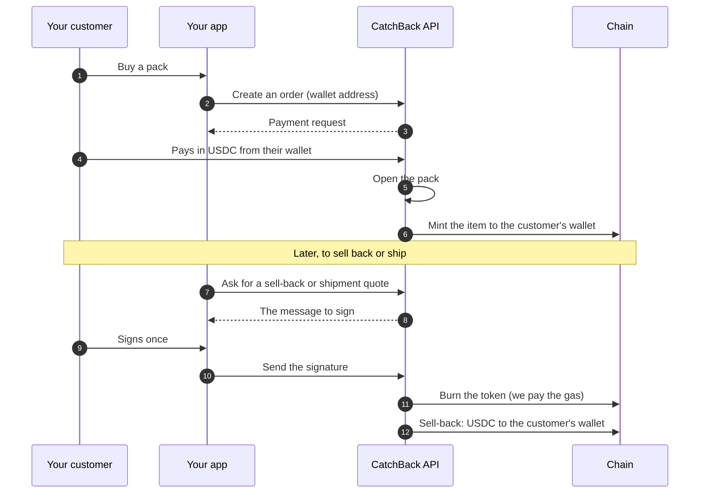
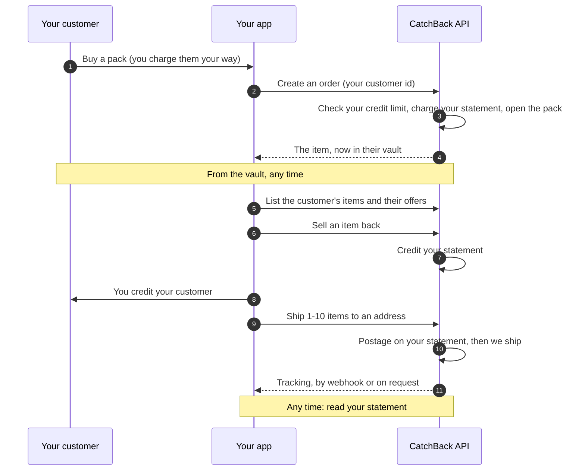

CatchBack is a platform where collectors can create mystery packs of collectibles: graded Pokémon and sports cards, watches, jewelry and streetwear. Partner API v2 lets exchanges, prediction markets and wallet platforms distribute those packs to their own users, white-labeled.

<Note>
  **Building a client, an SDK or a tool?** Generate it from the OpenAPI 3.1 spec, the official contract: `https://catchbackcards.mintlify.app/partner-api/v2/openapi.yaml`. It has every endpoint's method, path, parameters, responses and error codes, so you don't need to read them off these pages. AI assistants can call the API directly through the [MCP server](/partner-api/v2/mcp).
</Note>

## CatchBack in one minute

1. **A user buys a mystery pack** in your app. Each pack holds one real item, drawn with [provably fair](/partner-api/v2/verify-a-pull) odds the user can see before buying.
2. **The user receives the item they pulled.** The real item stays safe in our vault. Depending on your [payment model](/partner-api/v2/integration-models), the user gets it as a digital representation (NFT) in their own wallet, or it's held in their CatchBack vault and shown in your app.
3. **The user keeps it, sells it back, or has it shipped.**
   - **Keep it**, or trade it with other collectors.
   - **Sell it back to us:** on our standard terms, up to 100% of its value in the first 5 minutes, then a guaranteed 80% with no expiry. Your program's buyback rate is agreed with you ([Your program's terms](/partner-api/v2/integration-models#your-programs-terms)).
   - **Have it shipped:** we mail the real item to their door.

## How it works: two models

Every pack pulls a real item that we store. Where that item goes, and how money moves, depends on which of two models your program uses.

| If your customers… | You use | The item goes |
|---|---|---|
| have a crypto wallet with you | **Crypto Wallet model** | to their wallet, as an NFT on Base, Solana or your own chain, the moment the pack opens |
| don't have a crypto wallet | **Non-crypto model** | into a CatchBack vault kept for that customer |

Either way, the packs you sell, their odds and your customers' buyback rate are [agreed with you](/partner-api/v2/integration-models#your-programs-terms), and your customers always buy and sell back at the terms they're shown. You choose the model in **Get started** in your manager before you go live.

### Who's involved

<CardGroup cols={2}>
  <Card title="CatchBack" icon="vault">
    We hold the physical items, run the packs and the sell-back offer, and ship.
  </Card>
  <Card title="You" icon="store">
    You sell packs in your own app, calling our API with your key, and earn a revenue share.
  </Card>
  <Card title="Your customer" icon="user">
    Buys through your app. Never needs a CatchBack login.
  </Card>
  <Card title="Their wallet, if they have one" icon="wallet">
    The crypto wallet they already have with you. We never create it or hold its keys.
  </Card>
</CardGroup>

### Crypto Wallet model

Your customer pays from their own wallet, and the item is minted to it as an NFT, on Base, Solana or your own chain. They sell back or ship by signing one message, and we pay the gas.



### Non-crypto model

You pay for your customers' packs and receive their sell-backs, on one statement. Their items stay in a vault we keep for each customer. Your customers never see a crypto step; you charge and credit them however you like.



### Side by side

| | **Crypto Wallet model** | **Non-crypto model** |
|---|---|---|
| **Who the customer is** | Their wallet address | Your customer id |
| **Who pays for a pack** | The customer, in USDC from their wallet | You, on your statement |
| **Where the item goes** | Minted to their wallet | Their vault with us |
| **Sell back** | Customer signs once; USDC to their wallet | One API call; credited to your statement |
| **Ship** | Customer signs once; postage paid in the same step | One API call; postage on your statement |
| **Chain** | Base, Solana or your own chain | None |
| **Crypto your customer sees** | A wallet and one signature | None |
| **Your revenue share** | Paid monthly to your USDC address | Credited to your statement when each month closes |

Your customer never holds a CatchBack balance: on the Crypto Wallet model, money moves between their wallet and us; on the Non-crypto model, only between you and us. **[Integration models](/partner-api/v2/integration-models)** goes further: an item's life, where every payment goes, your program's terms, guarantees, and which endpoints each model uses.

## Why partners integrate

- **A new product with no inventory.** We source, store and ship every item, and back every digital representation with the real thing.
- **Revenue share on every pack.** The standard share is 3% of every pack opening. Premier partners earn more. See [your revenue statement](/partner-api/v2/endpoints/get-revenue).
- **No inventory and no custody.** We hold every real item. On the Crypto Wallet model you don't prefund or touch money at all: your users pay us directly and their items and payouts go to their wallets. Non-crypto model needs no prefunding either: you settle a statement with us, within a credit limit.
- **A safety net your users can see.** The guaranteed buyback means every item they pull keeps a cash value.

## New to crypto?

On **Non-crypto model** your users never touch crypto, and neither do you: skip to [Non-crypto model](/partner-api/v2/settlement). The rest of this section is for the **Crypto Wallet** model.

You don't need crypto expertise to integrate. The API is ordinary JSON over HTTPS, and we handle every on-chain step for you:

- **Payments:** we give you a hosted payment screen, or an address to pay to. You never build a checkout or hold user funds.
- **Minting and gas:** we create each digital representation and pay the network fee. On EVM chains we can pay the fee for sell-backs and shipping too: the user signs, and we send the burn.
- **Payouts and refunds:** we send USDC straight to the user.
- **Shipping:** we pack and post the real item.

The one thing your users do need is **their own crypto wallet**, the kind where only they hold the keys. Their digital representations go there, and they sign from it for each item they sell back or ship (on EVM chains a signature is enough, so they need no gas). If your users already have wallets, as on an exchange or wallet app, there's nothing extra to set up.

If your users don't have wallets, use [Non-crypto model](/partner-api/v2/settlement) instead.

| Term | In plain terms |
|---|---|
| **Crypto Wallet model** | The user's crypto account. It holds their digital representations and USDC. |
| **Digital representation (NFT)** | A digital certificate of ownership. Here, each one stands for one real item in our vault. |
| **USDC** | Cryptocurrency equivalent of $1 US. |
| **Burn** | Permanently destroying a digital representation. A user burns one to sell it back or ship it, so the same item can never be claimed twice. |
| **Chain** | The network the digital representation lives on. We're chain agnostic: your program mints on Base, Solana or your own EVM-compatible chain, set when you join. |

## Who does what

Your platform is the storefront. CatchBack does everything behind it.

| Step | Your platform | CatchBack |
|---|---|---|
| **1. The user buys a pack** | Shows the packs and their odds. **Crypto Wallet model:** sends us the user's wallet address and opens our payment screen. **Non-crypto model:** charges the user its own way and sends us its id for them | Supplies the packs, prices and odds. **Crypto Wallet model:** takes the payment, and refunds it if anything goes wrong. **Non-crypto model:** puts the order on your statement |
| **2. The user receives their item** | Shows what they pulled | Opens the pack fairly. **Crypto Wallet model:** delivers the digital representation to their wallet, paying the network fee. **Non-crypto model:** holds it in their CatchBack vault |
| **3. The user keeps it, sells it back, or ships it** | Shows those options, and collects the shipping address | Buys it back at the guaranteed price, or packs and ships the real item with tracking |

<Note>
  **v2 replaces v1.** The v1 Partner API is retired. v2 has no prefunded partner balance: on the Crypto Wallet model each customer pays for their own pack, and on the non-crypto model you settle a statement within a credit limit.
</Note>

## The API flow

To start, sign up at [catchbackcards.com/partners/signup](https://catchbackcards.com/partners/signup) and get a sandbox key from your manager's **Get started** (about 5 minutes): see [Sandbox](/partner-api/v2/quickstart#before-you-start).

At purchase, each pack algorithmically selects one real item from our vault, with the same [provably fair](/partner-api/v2/verify-a-pull) draw on both models.

### Non-crypto model

```text
 1. POST /orders { customer }  ──▶ charged to your statement; each pack opens ─▶ in_vault
    webhook nft_order.updated, or GET /orders/{id}
 2. GET /customers/{customer}/vault  ──▶ their cards, each with today's sell-back offer

 3a. SELL BACK                                    3b. SHIP (1-10 cards in one box)
     POST /customers/{c}/cards/{id}/sellback          POST /customers/{c}/shipments/estimate
     payout credited to your statement               POST /customers/{c}/shipments → postage on your statement
     webhook sellback.updated                        webhook nft_shipment.updated, or
                                                     GET  /customers/{c}/shipments → tracking

 GET /settlement ──▶ what you owe against your credit limit, and every entry by customer id
```

No wallets, tokens or burns. Full details: [Non-crypto model](/partner-api/v2/settlement).

### Crypto Wallet model

The customer receives an NFT (a digital representation showing ownership) of that item in their wallet. They can then trade it, sell the hit back, or have the collectible shipped. Selling back and shipping burn the NFT.

```text
 1. POST /orders  (quantity 1-10) ──▶ order awaiting_payment + payment details (one payment)
 2. customer pays (Base or Solana, through Unifold) ─▶ paid
 3. we open each pack ────────────────────────────────▶ rolled   (order.pull is set)
 4. we mint each NFT to the customer's wallet ────────▶ minted   (order.token is set)
    every step after 1 ─▶ webhook nft_order.updated, or GET /orders/{id}

 5. the customer holds it, or trades it on any marketplace (the token is a standard NFT)

 6a. SELL BACK                                  6b. SHIP (one token, or up to 25 in one box)
     POST /tokens/{id}/quote  (10-min quote)        POST /shipments/estimate
     holder burns with the quote                    POST /shipments  → pay shipping once
     we see the burn → USDC sent                    GET  /shipments/{id}  → a burn per token
     webhook sellback.updated, or                   holder burns each token → we ship the box
     GET /quotes/{quote_id} → payout.tx_hash        webhook nft_shipment.updated, or
                                                    GET  /shipments/{id}  → tracking
```

#### Who delivers the digital representation?

We do, straight to the customer's wallet. Your platform passes us the wallet address and shows the result. It never holds the token, and it never touches the customer's money.

```text
 your platform:  POST /orders  { "recipient": "0x8f3c…" }   ◀── you only pass the address
 CatchBack:      mints the digital representation ──────────▶ customer's wallet
```

##### Step by step

1. **Collect the customer's wallet address** on your program's chain (`mint_chain` in the [catalog](/partner-api/v2/endpoints/list-packs)). On EVM, one address is the same on every EVM chain, so a customer who pays from Base receives the token at that same address on your chain.
2. **Create the order** with that address as `recipient` ([Create an order](/partner-api/v2/endpoints/create-order)). The response includes the payment details. Hand them to the customer, who pays within 24 hours in USDC on Base or Solana ([Payments](/partner-api/v2/payments)).
3. **We open the pack and mint the token.** Once the payment settles, the order moves `paid` → `rolled` (the item is chosen and `order.pull` is set) → `minted` (the token is confirmed on chain and `order.token` is set). We pay the minting fee. If a mint doesn't land, we retry it (`mint_failed`); the pack is never opened twice.
4. **Show the result.** Listen for the [`nft_order.updated`](/partner-api/v2/webhooks) webhook, or poll `GET /orders/{id}`. At `minted`, show the customer the item from `order.pull`.

A multi-pack order (`quantity` 2-10) is paid once, then each pack opens and mints on its own, so each unit moves through these statuses separately. Every status is listed in [Orders](/partner-api/v2/orders).

##### Where the money goes

On the Crypto Wallet model, every payment and payout moves between the customer and CatchBack directly.

| Money | Goes to | Details |
|---|---|---|
| **The customer's payment** | CatchBack, through our payment provider Unifold | You never collect or forward it |
| **Sell-back payout** | USDC to the holder's wallet, or to the quote's `payout_address` | Paid on Base for EVM programs and on Solana for Solana programs. Solana payouts aren't on yet, so Solana programs send a Base `payout_address` for now. See [Sell-back](/partner-api/v2/sell-back) |
| **Refund** | USDC on Base to the order's `refund_address` | Sent when the pack can't open after payment, the payment is more than 1% short, or it arrives after the 24-hour window. Defaults to `recipient` on EVM programs; required on Solana programs. See [Payments](/partner-api/v2/payments) |
| **Your revenue share** | You | Reported month by month on your [revenue statement](/partner-api/v2/endpoints/get-revenue) |

<Warning>
  `recipient` must be a self-custody wallet the customer controls, **never an exchange deposit address**. A digital representation minted to a deposit address lands in the exchange's wallet, and the customer may never be able to reach it.
</Warning>

<Note>
  Want to become a partner? Email [support@catchbackcards.com](mailto:support@catchbackcards.com).
</Note>
